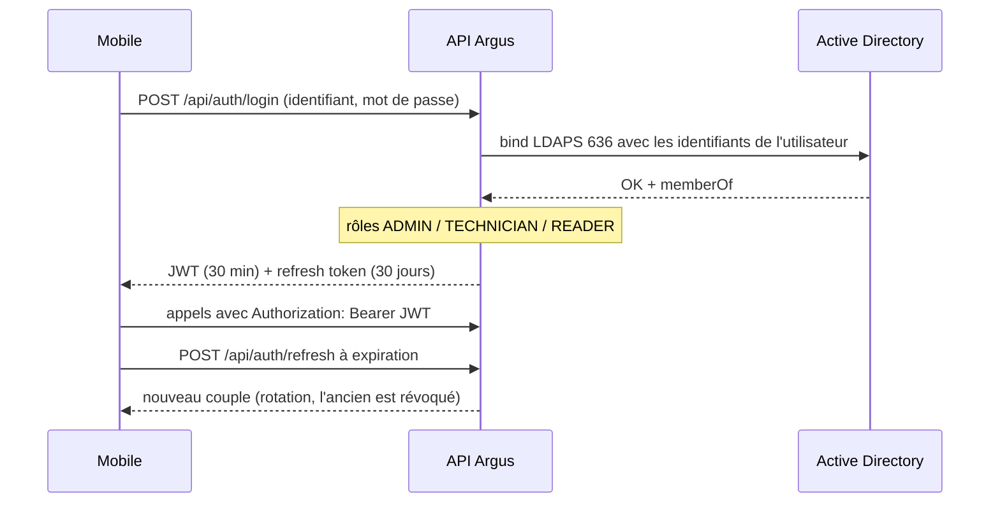

# Authentification et sécurité de l'API

Couvre : API-03 · lien avec SO-AR-12 (authentification via annuaire) et
DI3-DSO-DDO-C3-CRIT1 (secrets).

## Le parcours d'une connexion dans Argus

## Les notions à maîtriser

- **Authentification** (qui es-tu ?) ≠ **autorisation** (as-tu le droit ?).
- **Bind LDAP** : l'API s'authentifie auprès de l'annuaire *avec les
  identifiants de l'utilisateur* — aucun compte de service à protéger, l'AD
  reste l'autorité.
- **JWT** : jeton signé (HMAC, clé `Jwt__SigningKey`), contient des
  *claims* (identifiant, rôles, expiration). Le serveur le vérifie sans
  base de données. Il n'est pas chiffré : rien de secret dedans.
- **Refresh token** : longue durée, stocké **haché en SHA-256**, **rotation**
  à chaque usage, et **détection de réemploi** : présenter un jeton déjà
  révoqué révoque toute la famille (défense contre le vol).
- **`ClockSkew = 0`** : sinon .NET tolère 5 min de plus sur chaque jeton.
- **Rôles** : `[Authorize(Roles = "ADMIN")]` sur `PUT /api/hosts/{id}`. Le
  contrôle se fait **côté serveur** ; masquer un bouton dans l'app ne protège
  rien.
- **Moindre privilège** : le jeton Zabbix est sur un compte dédié en lecture
  seule ; le compte SQL `argus_api` n'a que les droits utiles.
- **Ne pas aider l'attaquant** : un 401 ne dit jamais si c'est le compte ou
  le mot de passe qui est faux (sinon on énumère les comptes).
- **Secrets** : uniquement en variables d'environnement (`.env` gitignoré,
  variables CI masquées). Jamais de mot de passe, jeton Zabbix ou jeton FCM
  dans les journaux.
- **Faux annuaire** en développement (`UseFakeDirectory`) : l'API **refuse
  de démarrer** s'il est actif en production.

## Ce qui reste ouvert (à savoir expliquer)

En prod, le bind échoue en **code LDAP 81** (« serveur injoignable »), avant
toute authentification. Sous Linux, ce code couvre aussi un **certificat
refusé** par libldap. L'exception complète est maintenant journalisée
(branche `fix-LDAP`) pour trancher entre réseau et certificat.

## Questions probables

1. *Pourquoi ne pas stocker le refresh token en clair ?*
2. *Que contient votre JWT ? Peut-on le modifier ?* → non, la signature
   ne correspondrait plus.
3. *Comment révoquez-vous une session ?* → révocation du refresh token ;
   l'access token expire en 30 min au plus.
4. *Différence LDAP / LDAPS ?* → 389 en clair, 636 en TLS.

Voir aussi : [Annuaire LDAP](../Annuaire-LDAP/ldap-active-directory.md).
