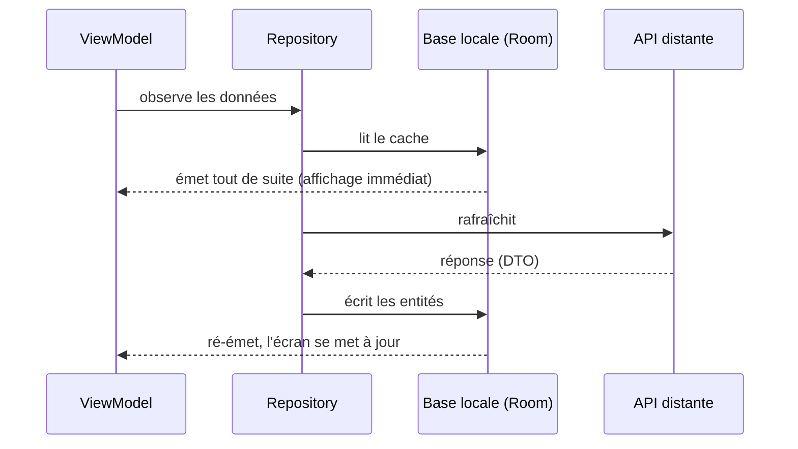

# Couches Data et Domain (mobile)

Couvre : CRIT-DMA-D2-S-2, S-3, SE-1, SE-3, SF-3, SF-4.

## Couche Domain

- **Domain Model** : l'objet métier, tel que l'app le pense (`Host`,
  `Alert`, `MetricSeries`, `HostHistory`). Pas d'annotation JSON, pas de
  Room.
- **Interface Repository** : le *contrat* d'accès aux données
  (`domain/repository/HostRepository.kt`). Le métier dit **ce dont il a
  besoin** (`loadHost(id)`, `loadMetrics(hostId, codes, days)`), pas comment
  on l'obtient.
- **`Resource<T>`** (`Loading / Success / Failure`) : l'état d'une donnée
  chargée. Oblige l'écran à traiter l'échec au lieu d'afficher une liste vide.

## Couche Data

Deux couples à connaître par cœur :

| Couple | Source | Exemple Argus |
|---|---|---|
| **Service / DTO** | distant (API REST) | `HostApi` (Retrofit) / `HostDto`, `MetricSeriesDto` |
| **DAO / Entity** | local (base Room) | `data/local/dao`, `entity/HostEntity` — **prévus mais pas implémentés** (US-23) |

- **DTO** : colle au JSON du contrat, champ pour champ (`kotlinx.serialization`).
- **Entity** : colle à la table locale (Room).
- **Mapper** : traduit DTO → modèle de domaine, et Entity ↔ modèle
  (`data/remote/mapper/HostMapper.kt`, `AlertMapper.kt`). C'est là qu'une
  valeur inconnue du serveur est ramenée à une valeur sûre.
- **Repository Impl** : orchestre les sources (`HostRepositoryImpl`) —
  pagination complète (`fetchAllPages`), appels parallèles (`async`/`awaitAll`
  pour les trois métriques).

## Le mécanisme de fetch (« local et distant »)

Stratégie classique **single source of truth** :

Avantages : affichage immédiat, mode hors ligne, une seule vérité. **Argus
ne l'a pas implémenté** (fetch distant uniquement) : à savoir l'expliquer et
dire honnêtement que c'est l'US-23 (mode dégradé), écartée du périmètre.

## Flux de données et découplage

- Ce qui traverse les couches : **les modèles de domaine**, jamais un DTO ni
  une Entity.
- Le Domain ignore d'où vient la donnée → on peut ajouter un cache sans
  toucher au ViewModel.
- Les erreurs réseau sont converties en message utilisateur
  (`toUserMessage()`) au bord de la couche Data/UI.

## Grille « Maîtrisé » (SE-1 / SF-4)

- [x] Fonctions et services commentés (KDoc sur les repositories).
- [x] Fonctions découpées, pas de duplication (`fetchAllPages` réutilisé).
- [x] Couple Service/DTO séparé et mappé.
- [ ] Couple DAO/Entity et fetch local + distant : **non fait** (Room en TODO).

## Questions probables

1. *Différence DTO / Entity / Model ?*
2. *Pourquoi un mapper plutôt que d'utiliser le DTO partout ?*
3. *Où est la règle « une alerte résolue ne compte pas » ?* → logique pure
   testée (`HostAlertSummary.byHost`, tests unitaires `HostSectionsTest`).
4. *Comment ajouteriez-vous le hors ligne ?* → Room + repository qui émet
   d'abord le cache.

Voir aussi : [Clean Architecture](../Architecture/clean-architecture.md).
