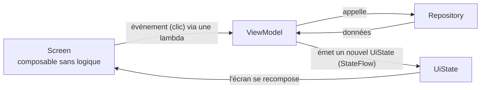

# Couche UI : Jetpack Compose, MVI, UDF

Couvre : CRIT-DMA-D2-S-4, SE-2, SF-2.

## Compose en trois idées

1. **Déclaratif** : on décrit l'écran *en fonction de l'état*
   (`UI = f(state)`), on ne le modifie pas à la main.
2. **Recomposition** : quand un état observé change, Compose réexécute
   seulement les composables concernés.
3. **État** : `remember` (survit à la recomposition), `rememberSaveable`
   (survit aussi à la rotation), `StateFlow` dans le ViewModel (survit à
   l'écran).

## MVI et flux de données unidirectionnel (UDF)



*L'état descend, les événements montent.*

- **Model** = `UiState` (data class immuable, ex. `HostDetailUiState` avec
  `host`, `alerts`, `metrics`, `history` en `Resource`).
- **View** = le composable, qui n'a **aucune logique** : il affiche l'état
  et remonte des lambdas (`onRetry`, `onAlertClick`).
- **Intent** (au sens MVI) = les actions du ViewModel (`load()`,
  `loadMetrics()`, `refresh()`).
- **Une entrée, une sortie** : un composable reçoit des données et des
  lambdas, rien d'autre (pas de ViewModel dans un composant partagé).

## Single Activity + navigation

Une seule `MainActivity` héberge un `NavHost` (`ArgusNavHost.kt`) ; chaque
écran est une destination. La barre du bas (`ArgusBottomBar`) change
d'onglet via une extension `NavHostController.navigateToTab()`.

## L'architecture d'un écran dans Argus

```
ui/screens/hosts/detail/
  HostDetailScreen.kt     XScreen : récupère le ViewModel (koinViewModel) et l'état
                          XContent : sans ViewModel → prévisualisable (@Preview)
  HostDetailViewModel.kt  StateFlow<UiState>, actions
  HostDetailUiState.kt    l'état
  HostDetailBody.kt …     sous-composables propres à l'écran
ui/core/component/        composants réutilisables (« LEGO ») : HostCard, GraphCard,
                          AvailabilityCard, CountFilterRow, MinSeveritySelector…
```

## Grille « Maîtrisé » (SE-2 / SF-2)

- [x] Une seule Activity.
- [x] Screen + ViewModel + UiState.
- [x] Composables découpés en LEGO, placés au bon endroit
      (`core/component/{layout,feedback,display,input,host,alert}`).
- [x] Actions du VM bien nommées (`loadMetrics`, `loadHistory`).
- [x] Le State contient des données de représentation (`MetricUi` :
      libellé, couleur, tendance).
- [x] Un composant complexe avec header KDoc (ex. `SmallGraph`,
      `AvailabilityBars`) — vérifier les block tags `@param`.

## Questions probables

1. *Différence `remember` / `rememberSaveable` ?*
2. *Pourquoi séparer `HostDetailScreen` et `HostDetailContent` ?* → un
   composable qui exige un ViewModel injecté ne se prévisualise pas.
3. *Où vit l'état d'un onglet sélectionné ?* → `rememberSaveable` dans
   l'écran : c'est de l'état d'UI, pas métier.
4. *Dessinez le flux UDF.* (schéma ci-dessus)
