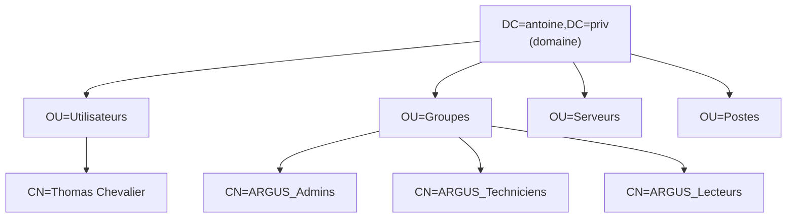

# Annuaire LDAP et Active Directory

Couvre : SO-AR-1 à SO-AR-10, SO-AR-12 (grille Système).

## SO-AR-1 — Fonctionnement d'un annuaire LDAP

- **LDAP** (*Lightweight Directory Access Protocol*) : protocole d'accès à un
  **annuaire**, une base hiérarchique optimisée pour la **lecture** (comptes,
  groupes, machines). Port **389** (clair, ou StartTLS), **636** (LDAPS).
- **Active Directory** : l'annuaire de Microsoft. Il s'appuie sur LDAP,
  **Kerberos** (authentification), **DNS** (localisation des contrôleurs).
- **Arborescence (DIT)** : chaque objet a un **DN** (*distinguished name*),
  son chemin complet :
  `CN=Thomas Chevalier,OU=Utilisateurs,DC=antoine,DC=priv`.
  - `DC` composant de domaine · `OU` unité d'organisation · `CN` nom commun.
- **Attributs** : `sAMAccountName`, `userPrincipalName` (`tchevalier@antoine.priv`),
  `memberOf`, `objectSid`, `mail`.
- **Opérations** : *bind* (s'authentifier), *search* (base DN + filtre
  `(sAMAccountName=tchevalier)` + portée), add, modify, delete.
- **Schéma** : définit les classes d'objets et les attributs autorisés.

## SO-AR-2 / 3 / 4 — Installation, objets, structure

- Installer le rôle **AD DS**, promouvoir en **contrôleur de domaine**,
  créer la forêt / le domaine (`antoine.priv`), DNS intégré.
- **Rôles FSMO** (« répartition des rôles structurants ») : maître de
  schéma, maître d'attribution de noms (forêt) ; RID, PDC émulateur,
  infrastructure (domaine).
- **Objets** : utilisateurs, ordinateurs, **groupes** (sécurité /
  distribution ; portée domaine local / globale / universelle), **OU**
  (conteneur structurant, cible des GPO et des délégations).
- **Stratégie AGDLP** : comptes → groupes Globaux → groupes de Domaine
  Local → Permissions.
- Argus : rôles applicatifs = groupes `ARGUS_Admins`, `ARGUS_Techniciens`,
  `ARGUS_Lecteurs`, lus dans `memberOf` après le bind.

## SO-AR-5 — Déploiement de configurations (GPO)

**Stratégies de groupe** liées à un site, un domaine ou une **OU** ;
configuration *Ordinateur* (au démarrage) et *Utilisateur* (à l'ouverture
de session). Ordre d'application **LSDOU** (Local, Site, Domaine, OU).
Filtrage par groupe de sécurité ou WMI pour cibler précisément.

## SO-AR-6 / 7 / 10 — Bonnes pratiques et sécurisation

- Mises à jour des contrôleurs, au moins **deux contrôleurs** de domaine.
- **Mots de passe** : stratégie (longueur, complexité, verrouillage),
  **FGPP** pour les comptes à privilèges, LAPS pour les admins locaux.
- **Tiering** et **bastion** : les comptes d'admin du domaine ne se
  connectent qu'aux contrôleurs, depuis un poste d'administration dédié.
- Pas d'usage quotidien d'un compte Domain Admin ; comptes de service
  dédiés au moindre privilège.
- **LDAPS / signature LDAP** obligatoires : jamais de bind simple en clair.
- Désactiver les protocoles faibles (NTLMv1, SMBv1).

## SO-AR-8 — Délégation de droits

*Assistant Délégation de contrôle* sur une OU : donner à un compte
d'administration spécifique (ex. `adm-helpdesk`) **seulement** la
réinitialisation des mots de passe des utilisateurs de l'OU, sans le rendre
admin du domaine. « Maîtrisé » = plusieurs délégations différentes sur
plusieurs comptes.

## SO-AR-9 — Contrôleur en lecture seule (RODC)

**RODC** : copie de l'annuaire **en lecture seule**, pour un site peu sûr.
Il ne stocke les mots de passe que des comptes autorisés par la **PRP**
(*Password Replication Policy*) : c'est la « mise en cache » de la grille.
Votre infra a deux contrôleurs (SRV-AD01, SRV-AD02) : vérifier avec les OPS
si le second est un RODC.

## SO-AR-12 — Authentification sécurisée via LDAP

Niveau « Maîtrisé » = **via un annuaire LDAP sécurisé** : c'est ce que fait
Argus.
- Bind avec les identifiants de l'utilisateur, au format UPN, en **LDAPS
  (636)**.
- Le certificat du contrôleur doit être **approuvé** par le client et son
  **nom** doit correspondre (`SRV-AD01.antoine.priv`) — d'où le nom DNS et
  non l'IP dans la configuration de prod.
- Codes LDAP utiles : **49** identifiants invalides, **81** serveur
  injoignable (sous Linux : aussi certificat refusé).

## Questions probables

1. *Lisez-moi ce DN.*
2. *LDAP et Kerberos, quelle différence ?*
3. *Pourquoi LDAPS ?* → sinon le mot de passe circule en clair au bind.
4. *Comment Argus sait qu'un utilisateur est admin ?* → `memberOf`
   contient `CN=ARGUS_Admins,…`.
