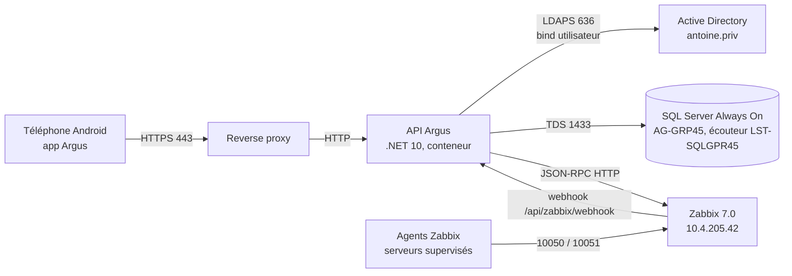

# Architecture logique et physique d'Argus

Couvre : ASI-4, ASI-5, ASI-6, OSI-700-5 (documentation d'architecture) ·
sert aussi à la soutenance.

## Vocabulaire

- **Architecture logique** : les *rôles* et les *flux* (qui parle à qui,
  par quel protocole, sur quel port), indépendamment des machines.
- **Architecture physique** : les *machines* réelles (VM, hyperviseur,
  réseaux, adresses) qui hébergent ces rôles.
- **Types d'architecture** : monolithe, client-serveur, **n-tiers**
  (présentation / application / données), microservices. Argus est un
  **3-tiers** : appli mobile → API → bases (SQL Server + Zabbix).

## Schéma logique

## Les flux à savoir justifier

| Flux | Protocole / port | Pourquoi |
|---|---|---|
| Mobile → API | HTTPS 443 | TLS terminé au reverse proxy ; certificat auto-signé épinglé dans l'APK |
| API → AD | LDAPS 636 | bind avec les identifiants de l'utilisateur, chiffré |
| API → SQL | TDS 1433 | via l'écouteur Always On pour suivre la bascule |
| API → Zabbix | HTTP JSON-RPC | lecture du parc et des problèmes, acquittements |
| Zabbix → API | webhook HTTP | temps réel des alertes |
| Agents → Zabbix | 10050 (passif) / 10051 (actif) | remontée des métriques |

## Schéma physique (à compléter avec l'équipe OPS)

| Machine | Rôle |
|---|---|
| Srv02-API (10.4.205.31) | conteneur `argus-api` + reverse proxy |
| Srv01-API | second nœud API |
| SRV-SQLGRP45-01, SRV02-SQL | réplicas SQL Server Always On |
| SRV-AD01 (192.168.1.2), SRV-AD02 | contrôleurs de domaine `antoine.priv` |
| Srv-Zabbix, Srv-ZabbixDB, Srv-ZabbixFront | supervision (« Cluster Zabbix ») |
| Srv-GitLab, Srv-GitlabDB | forge |
| FW-PFSENSE01 | pare-feu, DMZ |
| SRV-HYPER-V, GROUPE5-HYPERV | hyperviseurs |

> Ces noms viennent de l'inventaire Zabbix d'Argus. Les adresses et le
> découpage en réseaux sont à vérifier avec les OPS avant la soutenance.

## Ce qui rend une documentation « Maîtrisé »

Une nouvelle équipe doit pouvoir reprendre **sans autre information** :
schéma logique **et** physique, rôle de chaque serveur, flux avec ports et
protocoles, règles de filtrage, emplacement des secrets, procédure de
démarrage et de déploiement. Employer le vocabulaire exact (DMZ, écouteur,
réplica, bind, reverse proxy, TLS).

Voir aussi : [Clean Architecture](clean-architecture.md),
[Réseau et sécurité](../Reseau-Securite/pfsense-dmz.md).
