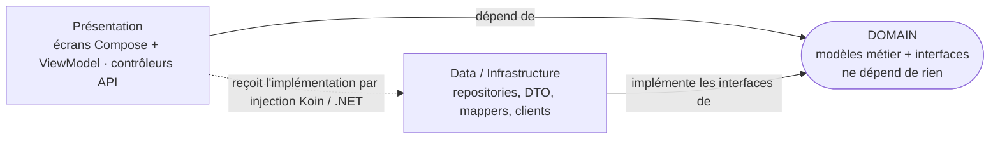
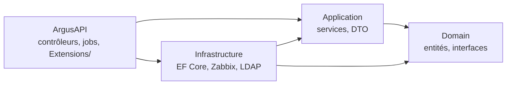

# Clean Architecture — le fil rouge des deux applications

Couvre : CRIT-DMA-D2-S-1, S-3, SF-1, SF-3 (mobile) · API-05 (structure du back).

## L'idée en une phrase

On range le code en **couches concentriques**, et **les dépendances pointent
toujours vers l'intérieur** : le cœur métier ne connaît ni la base de
données, ni le réseau, ni l'écran. Conséquence : on peut changer un
framework (Retrofit, EF Core, Compose) sans toucher aux règles métier, et on
peut tester le métier sans rien démarrer.



## Rôle de chaque couche

| Couche | Contient | Ne doit jamais contenir |
|---|---|---|
| **Domain** | modèles métier (`Host`, `Alert`), **interfaces** de repository, règles métier | Retrofit, Room, EF Core, Android, JSON |
| **Data** | implémentations des repositories, DTO, entités, mappers, clients HTTP | logique d'affichage |
| **Présentation** | écrans Compose + ViewModel (mobile), contrôleurs (API) | requêtes SQL, appels HTTP directs |

**L'inversion de dépendance** est le mot-clé : le Domain *déclare* une
interface (`HostRepository`), la couche Data *l'implémente*
(`HostRepositoryImpl`). Le ViewModel ne connaît que l'interface. C'est
l'**injection de dépendances** (Koin côté mobile, conteneur .NET côté API)
qui relie les deux au démarrage.

## Dans Argus — mobile (`frontend/app/src/main/java/fr/cucdb/argus/`)

```
domain/   model/ (Host, Alert, MetricSeries…)  repository/ (interfaces)  common/Resource
data/     remote/{api,dto,mapper}  repository/ (…Impl)  local/ (SessionManager, TokenStorage)
ui/       screens/<écran>/ (Screen + ViewModel + UiState)  core/component/  core/navigation/
di/       NetworkModule, RepositoryModule, ViewModelModule, SecurityModule (Koin)
```

Flux d'une donnée : `HostApi` (Retrofit) → `HostDto` → **mapper**
`toDomain()` → `Host` (domaine) → `HostRepositoryImpl` → `HostDetailViewModel`
→ `HostDetailUiState` → `HostDetailScreen`.

## Dans Argus — API (`backend/ArgusAPI/`)



Règle tenue : `Application` ne référence **que** `Domain`. Exemple : le
service n'a pas accès à `IOptions<ZabbixOptions>` ; il passe par une
interface `ISyncSchedule` implémentée dans Infrastructure.

## À savoir dire à l'oral

- **Pourquoi** : indépendance des frameworks, testabilité, maintenance,
  travail en parallèle (le mobile a avancé contre un mock grâce au contrat).
- **Séparation des préoccupations** : chaque classe a une seule raison de
  changer.
- **Un DTO ne remonte jamais jusqu'à l'écran** : le mapper le traduit en
  modèle de domaine. Si l'API renomme un champ, seul le mapper change.
- **Le repository est une abstraction de la source** : le ViewModel ne sait
  pas si la donnée vient du réseau ou d'un cache.

## Questions probables

1. *Quelle couche peut dépendre de quelle autre ?* → tout pointe vers Domain.
2. *Où mettez-vous l'interface du repository et pourquoi ?* → dans Domain,
   pour que le métier ne dépende pas de l'implémentation.
3. *Que se passe-t-il si on remplace Retrofit par Ktor ?* → seule la couche
   Data change.
4. *Montrez un mapper.* → `data/remote/mapper/HostMapper.kt`.

Voir aussi : [Android — Data et Domain](../Android/couches-data-domain.md),
[Architecture d'Argus](architecture-argus.md).
