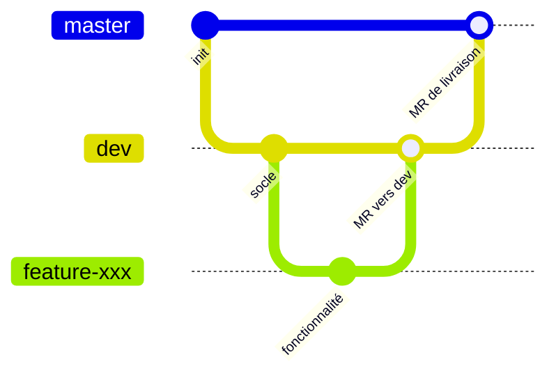

# GitLab et CI/CD

Couvre : DSO-DA-200-1, 2, 3, 5, 7 · DFS-04 · DI3-DSO-DDO-C3-CRIT1 · C-DSO-SS-5.

## GitLab (DSO-DA-200-1)

Forge Git auto-hébergée : groupe → projets (`Back`, `Front`), issues,
jalons (sprints), labels, merge requests (revue + approbation), pipelines
exécutés par des runners, variables CI.

## Travail en équipe (DSO-DA-200-2)

Une branche par fonctionnalité (`feature-alarm`, `feature-ui-host`,
`fix-LDAP`), MR vers `dev`, puis `dev` → `master` pour livrer. Le back a
déjà livré `dev` dans `master`, le front pas encore : c'est ce qui manque
pour « Maîtrisé ».

## La chaîne (DSO-DA-200-3, DSO-DA-200-5, DFS-04)

- CI : à chaque push, compiler et tester. CD : livraison continue
  (artefact prêt) ou déploiement continu (mise en prod automatique).
- Vocabulaire : pipeline → stages → jobs, runner (exécuteur docker),
  image, artefact, cache, rules, variables masquées / protégées / File.

| Job | Quand | Fait |
|---|---|---|
| `build-apk` | chaque push | `assembleDebug`, APK debug en artefact |
| `build-apk-release` | manuel, branche par défaut | `assembleRelease` signé avec le keystore des variables CI |

Choix : image publique `ghcr.io/cirruslabs/android-sdk:36` figée par
empreinte (reproductible), cache Gradle par branche, release manuelle.
Validé en local dans la même image. Limites : aucun runner actif (jobs
« stuck »), pas encore de job de tests.

## Documentation (DSO-DA-200-7)

Le `.gitlab-ci.yml` est commenté. Pour « Maîtrisé » : une page sur les
étapes, déclencheurs, artefacts, secrets et la stratégie de branches.

## Configuration et secrets (DI3-DSO-DDO-C3-CRIT1)

Config sans secret, valeurs sensibles en variables d'environnement, `.env`
gitignoré avec un `.env.example` versionné, keystore hors dépôt et en
variable CI File masquée et protégée, aucun secret dans les journaux.

## Collaboration (C-DSO-SS-5)

Contrat d'API figé pour paralléliser mobile et back, MR relues, relances
structurées vers les OPS, US réparties par jalon.
