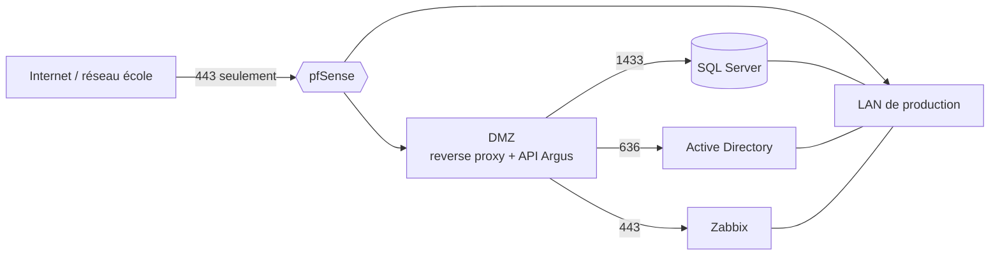

# Pare-feu pfSense, DMZ et documentation sécurité

Couvre : SO-CY-1, SO-CY-2, SO-CY-4, SO-CY-5, ASI-7.

## SO-CY-1 — Fonctionnement d'un pare-feu applicatif

- **pfSense / OPNsense** : distributions FreeBSD de pare-feu-routeur.
- **Filtrage à états** (*stateful*) : une connexion autorisée à l'aller
  l'est automatiquement au retour.
- Règles appliquées **par interface, sur le trafic entrant**, de **haut en
  bas, la première qui correspond gagne**, refus implicite à la fin.
- **NAT** : *port forward* (exposer un service interne), NAT sortant.
- **Alias** : groupes d'IP ou de ports nommés (`SRV_API`, `PORTS_WEB`).
- Services : DHCP, résolveur DNS, VPN (OpenVPN / IPsec / WireGuard),
  paquets (Snort/Suricata pour l'IDS/IPS, HAProxy pour la répartition).

## SO-CY-2 / 5 — Mise en place et bonnes pratiques

- **Politique par défaut : tout refuser**, puis ouvrir au strict nécessaire
  (source, destination, port précis — jamais `any → any`).
- Interface d'administration **jamais exposée** côté WAN, accessible depuis
  un réseau d'administration uniquement, en HTTPS, compte `admin` renommé ou
  désactivé, MFA si possible.
- Journaliser les règles de refus utiles ; sauvegarder la configuration.
- **Accès distant par VPN** avec règles limitées au besoin. Exemple réel du
  projet : votre VPN (10.200.0.0/24) ne route pas le réseau 192.168.1.0/24 ;
  la bonne réponse n'est **pas** d'ouvrir le 1433 à tous, mais une règle
  limitée au VPN → serveur SQL:1433 (et AD:636).

## SO-CY-4 — DMZ

**Zone démilitarisée** : réseau intermédiaire qui héberge ce qui doit être
joint de l'extérieur (reverse proxy, API), séparé du LAN de production.

Règles types :
| De | Vers | Port | Décision |
|---|---|---|---|
| WAN | DMZ reverse proxy | 443 | autoriser |
| DMZ API | LAN SQL (écouteur) | 1433 | autoriser |
| DMZ API | LAN AD | 636 | autoriser |
| DMZ API | Zabbix | 80/443 | autoriser |
| Zabbix | DMZ API | 443 (webhook) | autoriser |
| DMZ | LAN | * | **refuser** |
| WAN | LAN | * | **refuser** |

Principe : si la DMZ est compromise, l'attaquant n'atteint que les ports
strictement ouverts.

## ASI-7 — Documenter la sécurité

Tableau des règles (comme ci-dessus) avec la **justification** de chacune,
schéma des zones, gestion des certificats (certificat auto-signé de l'API
épinglé dans l'APK, expire le 6/10/2027), gestion des secrets, comptes de
service et leurs droits.

## Questions probables

1. *Dans quel ordre pfSense évalue-t-il les règles ?*
2. *Pourquoi une DMZ ?*
3. *Que mettez-vous dans la DMZ dans Argus ?*
4. *Stateful, ça veut dire quoi ?*
